<p align="center">
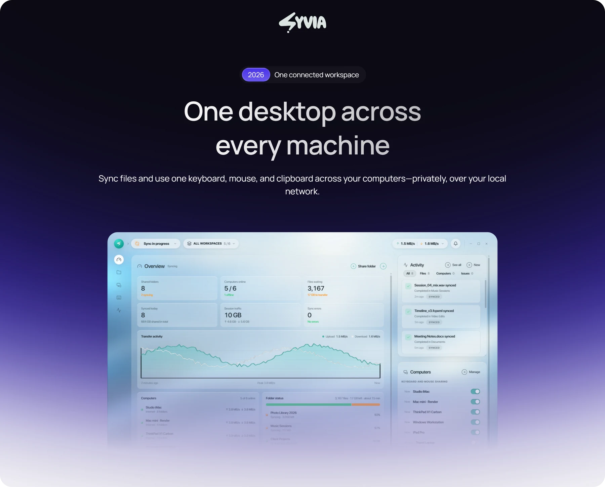
</p>

<p align="center">
<a href="https://github.com/DigitxlLink-LLC/sysvia-release/releases/latest"></a>


</p>

<p align="center">
<a href="https://github.com/DigitxlLink-LLC/sysvia-release/releases/latest"><b>Download Sysvia 2.2.0</b></a>
&nbsp;·&nbsp;
<a href="#new-in-220">New in 2.2.0</a>
&nbsp;·&nbsp;
<a href="#remote-screen-and-extended-monitors">Remote screen</a>
&nbsp;·&nbsp;
<a href="#install">Install</a>
&nbsp;·&nbsp;
<a href="#how-it-works">How it works</a>
&nbsp;·&nbsp;
<a href="#security">Security</a>
&nbsp;·&nbsp;
<a href="#notifications">Notifications</a>
&nbsp;·&nbsp;
<a href="#shortcuts-and-game-mode">Game mode</a>
&nbsp;·&nbsp;
<a href="#updating">Updating</a>
&nbsp;·&nbsp;
<a href="#beta-program">Beta program</a>
&nbsp;·&nbsp;
<a href="#whats-new">What's new</a>
&nbsp;·&nbsp;
<a href="#set-up-a-desk">Set up a desk</a>
&nbsp;·&nbsp;
<a href="#reference">Reference</a>
</p>

## New in 2.2.0

**The biggest update since 2.0.** Easier to set up, plainer to read, and much harder to attack.

| | |
| --- | --- |
| **Remote screen** | See and use another computer's screen from yours, with its pointer drawn. Off until the person at that computer allows it, and a bar shows whenever someone is looking. |
| **Extended monitors** | Another computer's monitors become extra screens on this one, with no cable, in both directions: a Mac can lend its monitors to a PC, and a PC to a Mac. |
| **Workspaces, in plain words** | A workspace is a group of your computers that work together. No blocking first screen: the first computer you add starts **My computers**, and the next ones join it. |
| **Notifications, per computer** | Choose which of your computers pop up alerts, with three simple settings: **Everything**, **Important only** or **Off**. |
| **Add a computer in one step** | A Device ID, a name and a workspace. Everything else is under **More options**. |
| **Connect from anywhere** | Off by default. Computers on different networks find each other, with no router changes. |
| **A safer Sysvia** | Only computers you added can reach your keyboard and mouse, and Sysvia's background services answer only to the app. |
| **Clearer and more private** | **Desk** is now **Input sharing**, and network addresses show as dots until you click them. |

> [!IMPORTANT]
> **Update every computer on a desk.** Keyboard and mouse sharing is stricter in 2.2.0, and a desk works best when all of its computers run the same version. Paired computers stay paired. The full list is under [2.2.0](#220) in What's new.

## Remote screen and extended monitors

Two new ways to use another one of your computers, from the **Remote** page in the sidebar. Both are off until the person at that computer turns them on.

| | |
| --- | --- |
| **Remote screen** | See and use another computer's screen from yours. Every screen of that computer shows, full screen or at actual size, with its pointer drawn, and you can type and click on it if you were allowed to. Open it from a computer's card with **See screen**, or with `Ctrl+Alt+D` (`Control+Option+D` on a Mac). |
| **Extended monitors** | Another computer's monitors become extra screens on this one, with no cable, in both directions. Drag windows between your own screens and the added ones, which are placed the way your **Desk layout** places the computers. Start it from a computer's card with **Add its monitors**, or lend yours with **Lend my monitors**. `Ctrl+Alt+1` (`Control+Option+1` on a Mac) flips the keyboard and mouse between the two computers. |

**You stay in charge.** Nothing is shared until the person at a computer turns it on, then chooses which of their other computers may look and which may take control, and can be asked each time. A bar across the top of the screen shows whenever someone is looking or controlling, with a **Stop** button, and turning extended monitors off ends the session. The **Remote** page lists recent activity: who looked at or controlled this screen, and for how long.

**The Remote page** asks what you want to do and with which computer, then walks you through the steps. **Set it up for me** does every step Sysvia can and says what only the other computer can do. Beside it you see what is on right now, your screens drawn to one scale and your shortcuts. The **Advanced** view has every control.

**What you need**

- Both computers paired, with Sysvia open. On one network it works straight away. Between networks, turn on **Connect from anywhere** on both.
- On a Mac whose screen is shared, allow **Screen Recording** (and **Accessibility**, to let someone control it) when macOS asks. Only the person at the Mac can do this, so the first session needs someone there.
- A Windows PC that lends its monitors needs a virtual display driver, installed once from the Remote page with administrator permission (Windows 11, 64-bit). A Mac lends monitors with nothing to install.

## What it does

<p align="center">
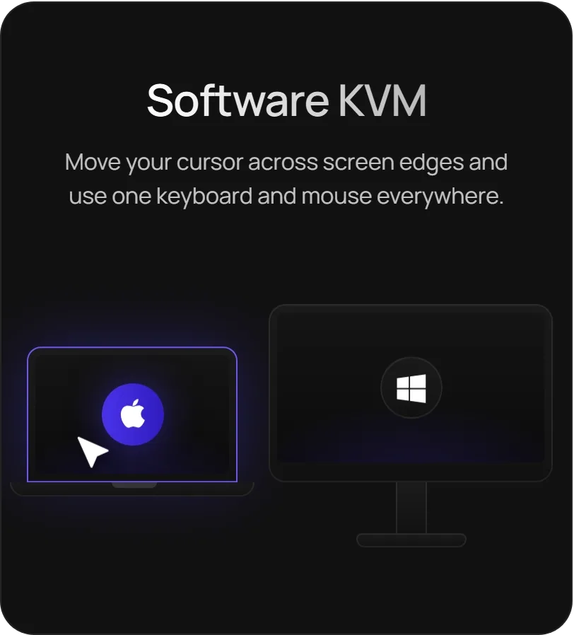
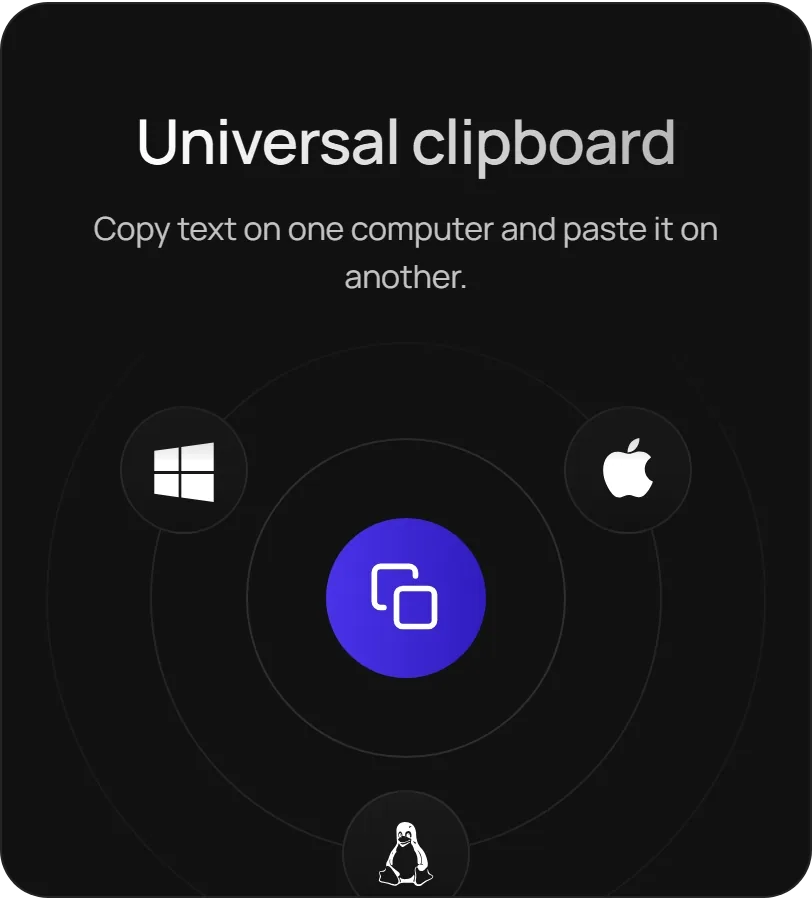
</p>

<p align="center">
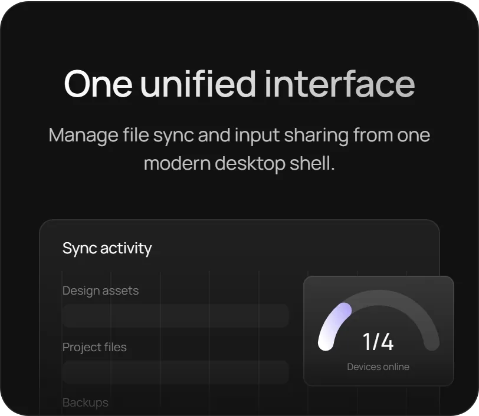
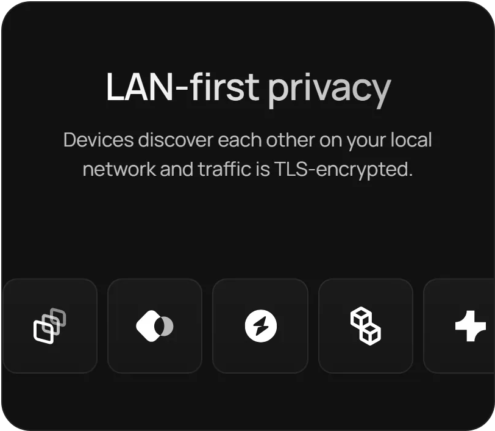
</p>

Sysvia keeps folders in sync between your computers and lets one keyboard and mouse control several of them. Nothing goes through a cloud service. Computers find each other on your network and talk directly.

| | |
| --- | --- |
| **Folder sync** | Continuous, peer to peer, on Sysvia's own engine. Receive-only folders, a 7-day undo for removed files, interrupted transfers that resume, and renames that move at once. |
| **Workspaces** | Group your computers the way you use them, like a home office or a studio, and choose which of them show notifications. |
| **Input sharing** | One keyboard and mouse across several computers, set up as a desk. Push the pointer off a screen edge and it lands on the next machine. |
| **Remote screen** | See and use another computer's screen from yours, once the person at it allows that. |
| **Extended monitors** | Use another computer's monitors as extra screens on this one, with no cable. |
| **Clipboard** | Copy text or an image on one computer, paste it on another. Screenshots and "Copy image" work between Windows and Mac. |
| **Shortcuts and game mode** | Keys that work from anywhere on the computer, and a game mode that stops the keyboard and mouse from leaving it while you play. |
| **Notifications** | Desktop alerts when a computer connects, files arrive, something fails, or an update is ready. |
| **Connect from anywhere** | Optional. Computers on different networks find each other through your account, which only passes short signed notes. Off until you turn it on. |
| **Private by design** | Your files and clipboard never pass through a server of ours. No cloud storage. If two computers cannot reach each other, they can use a relay you run yourself, and it cannot read what it carries. Traffic is TLS and tied to device identities. See [Security](#security). |

## How it works

One app drives two background services on each computer. Folder sync and the desk are separate on purpose: you can use either without the other.

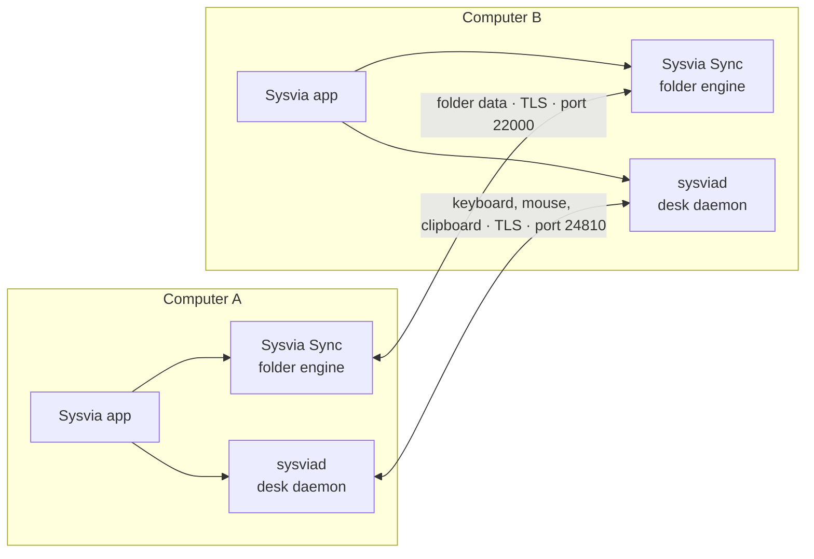

- **Discovery** is local. Folder discovery uses UDP 21037, the desk uses UDP 24812 and mDNS. Nothing is announced beyond your network.
- **Identity.** Every computer has its own Device ID and certificate. Pair two computers once and they recognize each other from then on.
- **Local control.** The app talks to its own services over `127.0.0.1` only. None of those ports are meant to be reachable from outside. See [Network ports](#reference).

## Security

Your files, clipboard and keystrokes stay between your own computers. Version 2.2.0 added a full round of hardening on top of that:

| | |
| --- | --- |
| **Encrypted, and tied to identities** | Every computer has its own Device ID and certificate. Traffic between computers is TLS, and a computer is recognized by its certificate, never by a name or an address. |
| **Your keyboard and mouse answer only to computers you chose** | The desk accepts a computer if you added it or connected to it yourself. Anything else on the network is turned away before it learns anything about your screens, and it cannot tie up the desk by connecting and saying nothing. |
| **Background services take orders only from the app** | The ports Sysvia uses on your own computer need a secret that only the app has: the desk service's is made again every time Sysvia starts, the file sync engine's once per computer. Other programs on the same computer cannot drive them. |
| **Deleting stays inside the folder** | Removing something through a link in a shared folder can no longer reach files outside it, and on Windows the administrator delete no longer writes a script file that could be swapped. |
| **Screens are off until you allow them** | Remote screen and extended monitors do nothing until the person at the computer turns them on. They then choose which computers may look or control, can be asked each time, and a bar shows whenever someone is looking. |
| **Local by default** | Finding computers happens on your network. The account is only used if you turn on [Connect from anywhere](#220), and it never sees file names, contents, keystrokes or screens. |

Found a security problem? Please tell us first at support@getsysvia.com.

## Screens

<p align="center">
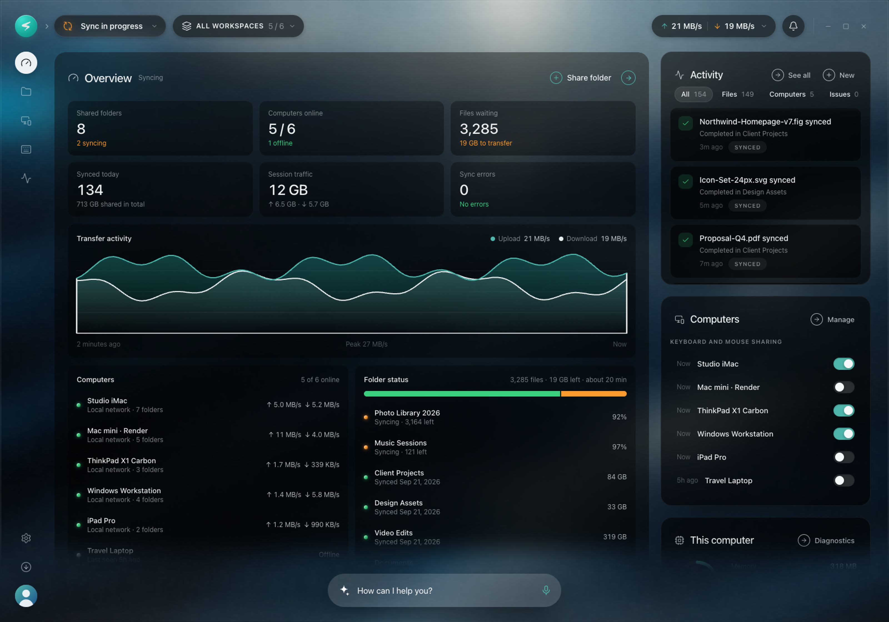
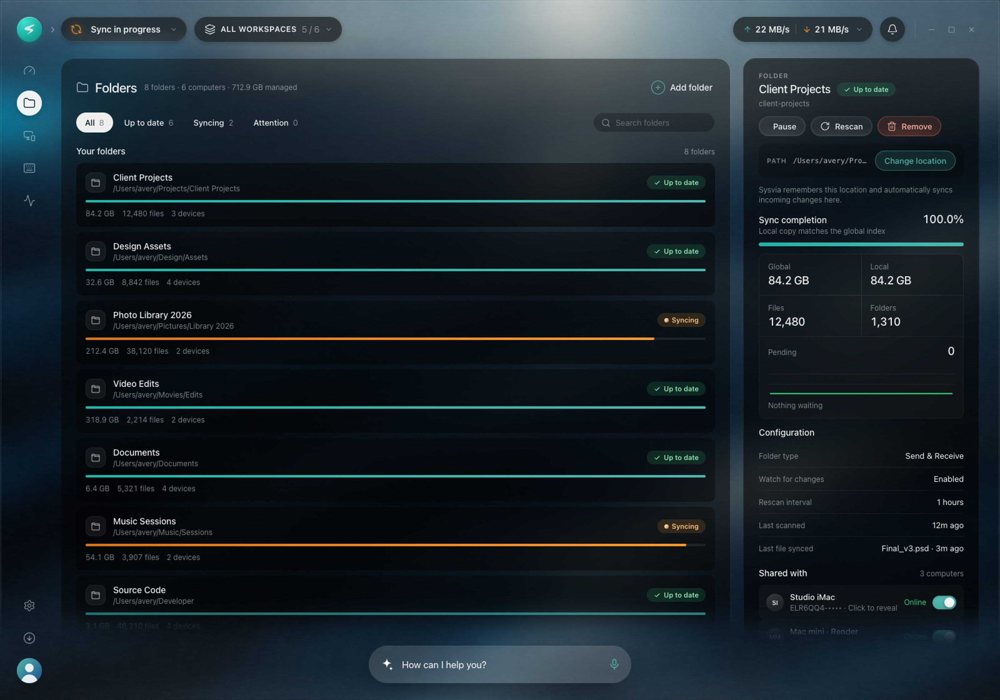
</p>

<p align="center">
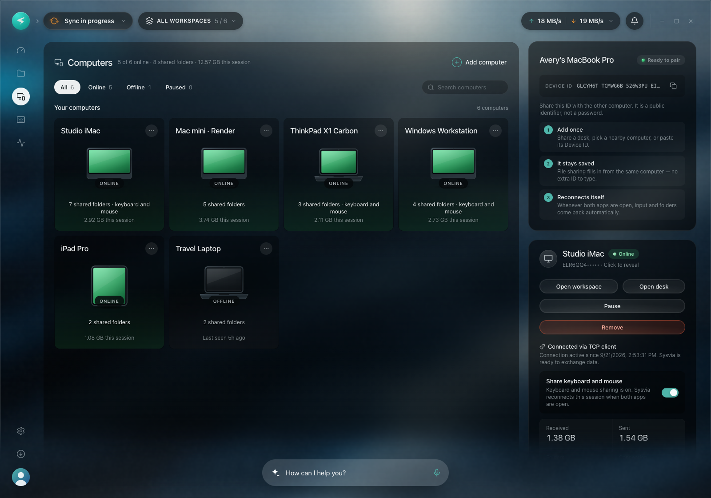
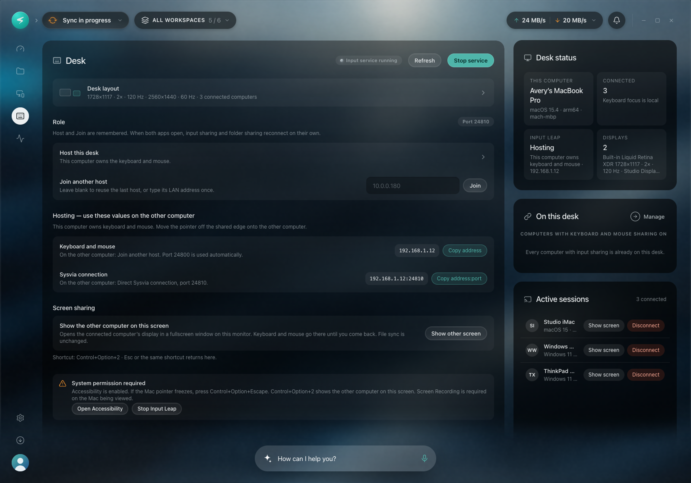
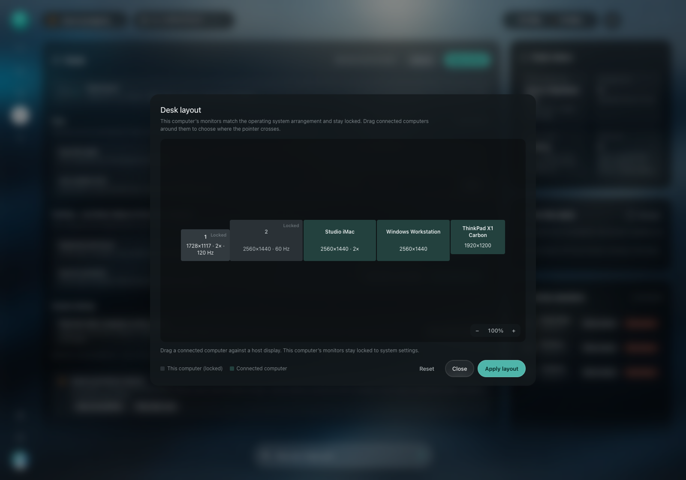
</p>

## Install

Download the installer for your computer from the [latest release](https://github.com/DigitxlLink-LLC/sysvia-release/releases/latest). A Linux installer is not available yet.

| Computer | File |
| --- | --- |
| Windows (x64) | `Sysvia-2.2.0-win-x64.exe` |
| Mac with Apple silicon (M1 and later) | `Sysvia-2.2.0-mac-arm64.dmg` |
| Mac with an Intel processor | `Sysvia-2.2.0-mac-x64.dmg` |

**Windows.** Run the installer. It installs per machine, asks for a directory (default `C:\Program Files\Sysvia`), and adds Start menu and desktop shortcuts. It also adds Windows Firewall allow rules for Sysvia's two background services. Uninstalling removes the rules and leaves your folders and settings alone.

**macOS.** Open the `.dmg` and drag Sysvia into Applications. The app is signed and notarized by Apple. On first launch macOS asks for Local Network access, and keyboard and mouse sharing needs the permissions listed under [macOS permissions](#macos-permissions). Not sure which Mac you have? Apple menu, then About This Mac: "Chip" says Apple M1 or similar, "Processor" says Intel.

The app checks this repository for updates a few seconds after launch, every ten minutes while it is running, and when you come back to its window or wake the computer.

<details>
<summary>Verify the download</summary>

<br>

The SHA256 of each installer is in [SHA256SUMS](SHA256SUMS). To check your copy:

```powershell
# Windows
Get-FileHash .\Sysvia-2.2.0-win-x64.exe -Algorithm SHA256
```

```sh
# macOS
shasum -a 256 ~/Downloads/Sysvia-2.2.0-*.dmg
```

</details>

## Notifications

Sysvia can tell you about things while it sits in the tray, on Windows and macOS. It watches the sync engine itself, so alerts arrive whether or not the window is open.

| You get a notification when | Example |
| --- | --- |
| A computer connects | **Studio PC connected** |
| A computer has been offline for more than 30 seconds, and again when it is back | **Studio PC went offline**, then **Studio PC is back online** |
| Files arrive from another computer | **cover.psd from Studio PC in Photos**, or **From Studio PC: 3 files updated** |
| A folder has a problem | **Photos needs attention**, or **Photos stopped syncing** |
| An update is available | **Update available**, once for each new version |

Alerts are kept calm on purpose:

- A computer that drops and returns inside 30 seconds is not announced, and connections made during the first 30 seconds after launch are not either.
- Files that arrive close together are grouped into one alert per folder instead of one per file.
- A folder that keeps failing is reported once every few minutes, not on every retry.
- Nothing is shown while the Sysvia window is in front of you. The app already shows it.
- Only the big events play a sound: updates, errors, and a folder finishing a large sync (10 or more files, or a sync that took 20 seconds or longer). Connections and small syncs are silent.
- Notifications cover files that arrive from your other computers, not changes you make on this one.

Clicking an alert brings Sysvia forward and opens the page it was about: Computers for connections, Folders for syncs and problems.

**Settings.** Open the bell at the top of the window, then the settings icon. Under **What should pop up on this computer?** choose **Everything**, **Important only** or **Off**. **More options** has the fine controls: **Desktop notifications** turns every alert off at once; **File syncs**, **Connections**, **Errors and alerts** and **Updates** switch each kind. Your choices are kept even when the window is closed to the tray. **Sound** turns Sysvia's notification sound on or off.

**Which computers show them.** Each workspace has a **Show notifications on** list, and every computer shows notifications until you untick it. Set it in the workspace editor, on the workspace card, or in the bell menu, where one switch per workspace controls this computer. It only holds back connection and file-sync pop-ups: problems, updates and security alerts always show, and a muted computer still lists everything in the bell menu. The choice follows your account. **Quiet hours** holds desktop alerts between two times you choose, across midnight if needed; the bell list still records them. **Send a test notification** shows a real alert and tells you why one did not appear: switched off, held by quiet hours, refused by the system, or hidden by Focus assist or Do Not Disturb.

**macOS.** Allow notifications for Sysvia the first time macOS asks, or later under System Settings, Notifications, Sysvia. Focus modes and Do Not Disturb hide them, as with any app.

**Windows.** Alerts come from the installed app and follow Focus assist. If you do not see them, check Settings, System, Notifications.

## Updating

**From 2.0.0 or later.** Just update. The app offers it, or download it above. Your computers stay paired and your folders stay as they are. Update every computer on a desk: keyboard and mouse sharing is stricter in 2.2.0, so if a computer you expect is turned away at first, open **Computers** on the host and switch **Share keyboard and mouse** on for it.

**From 1.x.** Version 2.0 replaced the file sync engine (1.x used Syncthing), and 2.0 computers cannot sync with 1.x computers. So update all of them, then set them up again:

1. Install 2.2.0 on every computer. Until every computer is updated, the ones that are not will stop syncing with the ones that are.
2. Sysvia 2.2.0 does not read your old Syncthing setup. Your files are not touched, but the folders are not added for you. On each computer, add each folder again and choose the folder you already have on disk.
3. Open **Computers** on each computer and pair them. Computers have new IDs in 2.0, so the old pairings do not carry over.
4. Share the folders between them. If both sides already hold the same files, nothing is sent again. Sysvia compares them and carries on.

If an old copy of Syncthing is still running on a computer, quit it first. It can hold the port Sysvia needs.

## What's new

### 2.2.0

The biggest update since 2.0. You can now see and use another computer's screen, and add its monitors to yours. Getting started is simpler, the app says what it means in plain words, and Sysvia is a good deal harder to attack. Your computers stay paired and nothing in your folders changes. Update every computer on a desk, since keyboard and mouse sharing is stricter.

**Remote screen.** See and use another computer's screen from yours. Every screen of that computer shows, full screen or at actual size, with its pointer drawn, and you can type and click on it if you were allowed to. It is off until the person at that computer turns it on. They choose which of their computers may look and which may take control, and can be asked each time, and a bar across the top of the screen shows whenever someone is looking, with a **Stop** button. On a Mac whose screen is shared, macOS asks for **Screen Recording** and **Accessibility** the first time, and only the person at the Mac can allow them. Open it with **See screen** on a computer's card on the new **Remote** page, or with `Ctrl+Alt+D` (`Control+Option+D` on a Mac).

**Extended monitors.** Another computer's monitors become extra screens on this one, with no cable, in both directions: a Mac can lend its monitors to a PC, and a Windows PC can lend its monitors to a Mac. Drag windows between your own screens and the added ones. The added screens are placed the way your **Desk layout** places the computers. Start it with **Add its monitors** on a computer's card, or lend yours with **Lend my monitors**. `Ctrl+Alt+1` (`Control+Option+1` on a Mac) flips the keyboard and mouse between the two computers, and turning it off ends the session. It is off unless the person at the computer that lends its monitors allows it. A Windows PC needs a virtual display driver for this, installed once from the Remote page with administrator permission (Windows 11, 64-bit). A Mac needs nothing installed.

**The Remote page.** It asks what you want to do and with which computer, then walks you through the steps. **Set it up for me** does every step Sysvia can and says what only the other computer can do. Beside it you see what is on right now, recent activity (who looked at or controlled this screen, and for how long), your screens drawn to one scale and your shortcuts. The **Advanced** view has every control. See [Remote screen and extended monitors](#remote-screen-and-extended-monitors).

**Workspaces, in plain words.** A workspace is a group of your computers that work together, like "Home office": a desktop and a laptop. The blocking "Create a workspace" screen is gone. You go straight into the setup tour, the first computer you add starts a workspace called **My computers**, and the next ones join it. When you add a computer you choose which workspace it joins, or start a new one. **Park** and **Activate** are now **Hide** and **Show**, which decide whether a workspace appears in Overview on this computer. An empty Overview says "Connect your first computer" and has an **Add a computer** button. The tour has two new steps: what a workspace is, and where notifications show.

**Add a computer, simplified.** The window asks for the Device ID (or a nearby computer), a name, whether to share the keyboard and mouse, and which workspace. The address, compression, which folders to share and "introduce other computers" are under **More options**.

**Choose which computers show notifications.** Each workspace has a **Show notifications on** list. Every computer shows notifications until you untick it, so your always-on desktop can stay quiet while your laptop keeps telling you what arrived. It only holds back connection and file-sync pop-ups. Problems, updates and security alerts always show, and a muted computer still lists everything in the bell menu. The choice follows your account. See [Notifications](#notifications).

**Three simple notification settings.** **Everything**, **Important only** or **Off**. Categories, sound and quiet hours are under **More options**. A connection notification no longer puts the computer's address on screen.

**Clearer names, more private screens.**

- The **Desk** page is now **Input sharing**. **Desk layout** keeps its name.
- Network addresses show as dots until you click them, on Profile, Input sharing, nearby computers and Diagnostics, so a screenshot or a screen share does not give them away.
- Settings no longer shows the app's internal key. Your own name is labelled **This computer's name**.
- The Input sharing page no longer has the "Show other screen" section or the system permission notice.

**Connect from anywhere (off by default).** Turn it on in **Settings** and your computers on different networks can find each other, with no router changes. Sysvia uses your account to pass short signed notes between your own computers, and nothing else. It never sees file names, file contents, keystrokes or screens, and nothing is stored: the notes are passed on live and gone. Both computers need it on, with Sysvia running.

**A safer Sysvia.** This release is the result of a full security review. See [Security](#security).

- Only computers you have added, or connected to yourself, can reach your keyboard and mouse. Anything else on the network is turned away before it learns a thing about your screens, and it cannot tie up the desk by connecting and staying silent.
- Sysvia's background services take orders only from the Sysvia app. Other programs on the same computer can no longer drive them.
- The file sync engine's key is made fresh on every computer and is no longer passed on the command line, where other programs could read it.
- Deleting through a link inside a shared folder can no longer reach outside it, and the administrator delete on Windows no longer writes a script file that someone could swap.

**Fix.** A key or mouse button held down by another computer is let go when that computer leaves, disconnects or goes quiet, so keys no longer stay stuck.

Computers paired on 2.0.x and 2.1.x stay paired. If a computer you expect is turned away at first, open **Computers** on the host and switch **Share keyboard and mouse** on for it.

### 2.1.6

**A guided setup for new computers.** The first time you sign in with your subscription, Sysvia walks you through connecting a computer, sharing a folder, and sharing your keyboard and mouse. It dims the rest of the app and lights up only the control to use, and you do each step yourself. Skip it any time, and replay it from **Settings**, then **General**, under **Setup help**.

**A short guide for every page.** The small **i** button in the header of Overview, Folders, Computers, Desk, Diagnostics and Settings walks you through that page and nothing else. You can also type "guide" in the search bar. The Desk guide now includes arranging your screens in **Desk layout**.

**Search by voice.** The microphone in the search bar now works. Click it, say what you want, and the words appear in the search box as you speak. Your voice is turned into text on your computer and is never sent anywhere. The speech model comes with Sysvia, so the download is about 70 MB larger, and the first time your computer asks whether Sysvia may use the microphone.

**Pointer lag after sleep or a slow network is shorter.** When the link between two computers stalls for a moment, for example just after one wakes from sleep, the operating system used to keep several seconds of mouse movement waiting to be sent, and the pointer then crawled through all of it once the link came back. Sysvia now keeps only a small amount waiting, and the extra movement is combined into one step, so the pointer catches up almost at once. Update every computer on the desk, since both sides send.

**A slow link leaves a note in the log.** When sending to another computer takes unusually long, Sysvia writes one line about it to the log (at most one a second), so a moment of lag can be matched with the moment the network struggled. It shows up in a support bundle.

### 2.1.5

**Your computers reconnect by themselves after sleep.** Close a Mac's lid, open it again, and the desk links to your other computers come back on their own, within about a minute, with no clicking and even if the Sysvia window is closed. Before, a link that dropped while a computer slept could stay listed as connected, and Sysvia only tried again when you opened the Desk page. Now Sysvia checks in the background, looks again as soon as the computer wakes or the screen unlocks, and drops a link that has stopped responding so it can be made again. If the other computer's address changed while it slept, Sysvia uses the new one. Update every computer on the desk to get the full effect, since part of the fix is in the background service.

**Less pointer lag after a slow moment.** If the network between two computers stalls for a few seconds, for example right after one wakes from sleep, the mouse no longer replays a long queue of old movements when the link recovers. Extra movement is combined into one step, so the pointer lands in the same place without the drawn-out catch-up.

### 2.1.4

**Updating on a Mac installs by itself.** Clicking **Update** now closes Sysvia, installs the new version and opens it again. Before, the window only hid to the menu bar and the update waited until you quit Sysvia by hand from the menu bar. The first update that brings this fix still needs one manual quit, because the version you are running does not have it yet.

**Leaving the beta takes you back to the public release.** If this computer is running a beta build, **Leave the beta** now switches it back to the latest public release: Sysvia downloads it and restarts. If you left from the website, **Settings**, then **Updates**, then **Beta program** has a **Switch to the stable release** button.

### 2.1.3

**Copy and paste images between Windows and Mac.** A screenshot (`Win+Shift+S` on Windows, `Cmd+Ctrl+Shift+4` on a Mac) or an image you right-click and Copy now pastes on your other computer, not just text. It follows the **Clipboard sharing** setting, so there is nothing new to switch on, and it is on for computers that had it off before. Images up to 10 MB are sent. If a copy holds both text and a picture (cells copied from a spreadsheet, for example), the text is what arrives. An image that came from another computer is not sent back to it.

**Beta program.** Members can now try upcoming versions before everyone else. It is opt-in and one click to leave: **Settings**, then **Updates**, then **Beta program**. Beta testers get a **Beta tester** badge on their profile in the app and on the website. See [Beta program](#beta-program).

Computers paired on 2.0.x and 2.1.x stay paired. Nothing to redo.

### 2.1.2

**Notifications you can tune.** Sync alerts now say which computer the change came from, such as "cover.psd from Studio PC in Photos". Only the big events play Sysvia's sound: updates, errors, and a folder finishing a large sync. Connections and small syncs are silent. A new **Quiet hours** setting holds desktop alerts between two times, and **Send a test notification** in the settings shows a real alert and tells you why one did not appear. See [Notifications](#notifications).

**Renames and moves are instant.** Rename a large file or move a whole folder and the other computers move their copy too, without sending any data. If the file is open in another program on the receiving computer, Sysvia falls back to copying and removing it, with no error and no duplicate.

**Override the others.** A send-only folder whose copies were changed on another computer now offers **Override the others**. It shows how many files were edited and added, and on confirming puts every computer back to your version. What it removes goes to the other computers' Recently removed files.

**Relay for computers that cannot reach each other.** Sysvia does not host a relay. You can run `sysvia-relayd` on any machine with a public address, then turn on Relaying and enter its address under Settings, Connections on both computers. They encrypt their traffic between themselves, so the relay carries data it cannot read or change. It is off until you set it up.

**Computers saved twice.** A computer that was listed twice, for example after a power cut, now merges into the entry that is online.

**Fix.** The remove button on a folder no longer stays stuck after the folder is deleted.

Computers paired on 2.0.x and 2.1.x stay paired. Nothing to redo.

### 2.1.1

**Change a folder's direction.** A folder's page has a Folder type menu: Send & Receive, Receive Only or Send Only. You can switch a folder without removing it, so a Receive Only copy can become two-way and keeps its place and its files. New folders accepted from another computer start as Send & Receive.

**Fix.** On Windows desks with monitors at different display scaling, the screens in the layout editor are now matched to the right physical monitor, so edges and cursor movement line up with what you see.

**Clearer sign-up.** Sign-up says up front what a password needs (12 or more characters with an uppercase letter, a lowercase letter, a number and a symbol) and tells you exactly which is missing. The confirmation link in the email now stays valid for 10 minutes, and you can ask for a new one after a minute. The support bundle in Settings says where to send it: support@getsysvia.com.

### 2.1.0

**Game mode.** One switch on the computer that is sharing its keyboard and mouse stops them from crossing to another computer, so the cursor stays put while you play. Turn it on from the **Desk** page or with a shortcut, and a **Game mode** badge in the header shows while it is on. It is always off when Sysvia starts. On Windows it also keeps the cursor on the monitor your game is running on, so it cannot drift onto a second screen where you cannot see it. See [Shortcuts and game mode](#shortcuts-and-game-mode).

**Shortcuts you can change.** A new **Shortcuts** tab in Settings lets you choose the keys for game mode, for viewing another computer's screen, and for bringing Sysvia to the front. They work from anywhere on the computer, even with a game in front, and changes apply right away. Sysvia tells you when a combination is already taken.

**On-screen confirmation.** A small message appears for a moment when a shortcut is used, even if Sysvia is minimized or a game is in front. It can be turned off in the Shortcuts tab.

**Fixes.** Removing a folder now fades its row out, and pressing the remove button twice no longer sends the request twice. If the background service is older than the app, game mode now says so instead of failing without a word.

Computers paired on 2.0.x stay paired. Nothing to redo.

### 2.0.2

**Desktop notifications.** Sysvia now tells you when a computer connects or goes offline, when files arrive from another computer, when a folder needs attention, and when an update is ready. Alerts are grouped and rate-limited so a big sync is one message, not hundreds, and they are held back while the window is in front of you. Clicking one opens the page it was about. Each kind can be switched off, and so can all of them. See [Notifications](#notifications).

**Faster updates.** Sysvia now looks for a new version a few seconds after launch and then every ten minutes, instead of every few hours. It also checks when you return to the window or wake the computer, and tries again soon after a failed check.

**Fix.** A folder whose errors had cleared no longer shows up in the activity list as "needs attention" with zero errors.

### 2.0.1

A cleanup release. The last pieces of the old Syncthing-based engine are gone, and file sync is named Sysvia Sync inside the app. Nothing changes in how you use Sysvia, and pairings made in 2.0.0 carry over. The one difference is for people updating from 1.x, who now add their folders again (see [Updating](#updating)).

### 2.0

**A sync engine written for Sysvia.** Syncthing is no longer part of the app. File sync now runs on Sysvia's own engine, so the installer no longer ships any Syncthing files. On many small files it is much faster. In our tests, with two copies running on one Mac, a first sync of 3,000 small files took about 1.6 seconds. The old engine took about 15. Large files take about the same time as before.

**Built to survive a power cut.** The computer's identity and settings are written to disk in a way that survives losing power, with a backup copy next to each, so a computer keeps its ID and does not turn up as a second computer afterwards. If the index of your files is damaged, Sysvia sets it aside and rebuilds it from your folders instead of downloading everything again. A transfer that was interrupted picks up from the blocks it already had.

**Undo for receive-only folders.** A folder set to receive changes only never sends what you change on that computer. If you have edited or added things there and want it back to how the others have it, open the folder and choose **Revert local changes**. What you had is moved to the folder's trash first, not deleted.

**Removed files can be restored.** When another computer deletes or replaces a file, the old copy is kept for 7 days in `.sysvia/trash` inside the folder. A new **Recently removed files** list on the folder page shows them, with a **Restore** button on each. If the file's old place is taken, it comes back next to it as `name (restored)` and nothing is overwritten.

**Each account has its own computers and folders.** If several people sign in to Sysvia on one computer, one account no longer sees another account's computers and folders. The first account to sign in after updating keeps the existing setup. Other accounts start with their own, which also means their own ID when pairing.

## Beta program

Want to try what is coming before it is released? Members with an active license can join the beta. You get new builds first, tell us what breaks, and get a **Beta tester** badge on your profile in the app and on the website.

1. Open **Settings**, then **Updates**, and find **Beta program**. You can also use **Account** on [getsysvia.com](https://getsysvia.com/dashboard).
2. Read the [Beta Program Terms](https://getsysvia.com/beta-terms), tick the box, and choose **Join the beta**.

From then on Sysvia looks for new builds in the [beta releases](https://github.com/DigitxlLink-LLC/sysvia-beta-release/releases/latest) instead of here. Beta builds can be unstable, so keep a backup of anything you cannot afford to lose.

**Leaving** takes one click: **Leave the beta** in the same place. Sysvia goes back to the releases here and your badge is removed. If this computer is running a beta build, leaving in the app also switches it back to the latest public release: Sysvia downloads it and restarts. If you left on the website, use **Switch to the stable release** in the same place in the app.

## Set up a desk

Install and open Sysvia on each computer. Then:

1. On the computer whose keyboard you want to use, open **Input sharing** and choose **Host this desk**.
2. On the other computer, choose **Join** and enter the host's LAN address. Input sharing can copy it for you.
3. Wait for that computer to appear under **Active sessions**. "Nearby" only means a discovery packet arrived.
4. Open the layout, snap the other computer to the edge it physically sits on, and apply.
5. Push the pointer off that edge.

> [!NOTE]
> Both computers must be open and on the same subnet. A desktop on Ethernet and a laptop on a different Wi-Fi range will not see each other.

Keyboard sharing is optional, and leaving it off does not stop folder sync. Folders can also sync beyond your local network, if the computers can reach each other directly, for example through a forwarded port or a VPN. The desk cannot. For folders that cannot reach each other directly, Sysvia does not host a relay, but you can run your own (see 2.1.2 under [What's new](#whats-new)).

## Shortcuts and game mode

These work from anywhere on the computer, even while a game or another app is in front.

| Shortcut | What it does |
| --- | --- |
| `Ctrl+Alt+Esc` | Take the pointer back if it sticks on the other computer. On a Mac: `Control+Option+Esc`. Built in, so it always works, and it cannot be changed. |
| `Ctrl+Alt+G` | Turn game mode on or off. On a Mac: `Control+Option+G`. |
| `Ctrl+Alt+2` | Show the other computer's primary display on this monitor. Press it again or `Esc` to close. On a Mac: `Control+Option+2`. |
| `Ctrl+Alt+D` | Open [remote screen](#remote-screen-and-extended-monitors) to another of your computers. On a Mac: `Control+Option+D`. |
| `Ctrl+Alt+1` | While another computer's monitors are added to yours, flip the keyboard and mouse between this computer and that one. On a Mac: `Control+Option+1`. |
| Not set | Bring the Sysvia window to the front. Choose your own keys for it. |

Everything except `Ctrl+Alt+Esc` can be changed under **Settings, Shortcuts**.

**Game mode** is for the computer that is sharing its keyboard and mouse (the host). While it is on, the pointer no longer crosses to another computer and your input stays on this one. Turn it on from the **Input sharing** page or with `Ctrl+Alt+G`. It always starts off when Sysvia launches and turns itself off if you stop hosting. On Windows it also holds the cursor on the monitor your game is on. Taking the keyboard back with `Ctrl+Alt+Esc` releases it.

<details>
<summary id="macos-permissions">macOS permissions</summary>

<br>

- **Local Network** must be allowed so Sysvia can find your other computers.
- **Accessibility** must be on for Sysvia and for `sysviad`. Restart after granting it.
- **Screen Recording** must be on for `sysviad` on any Mac whose screen you view from another computer.
- For [remote screen](#remote-screen-and-extended-monitors) macOS also asks about **Screen Recording** and **Accessibility** the first time someone looks at, or controls, this Mac. Allow the entries named Sysvia. Only the person at the Mac can do this.
- **Notifications** should be allowed if you want [desktop alerts](#notifications).

</details>

## Current limits

- No Linux installer yet.
- For a folder that already exists, ignore patterns and versioning are not editable yet.
- Folder sync needs the computers to reach each other, on the same network or directly, or through a relay you run yourself. Sysvia does not host one.
- The clipboard carries text and images (up to 10 MB each). Files and dragging a file across the desk are not supported. Share a folder instead.
- Keyboard and mouse do not cross subnets, a VPN or the internet.
- Remote screen and extended monitors need the two computers to reach each other, on one network or with [Connect from anywhere](#220) on both. Sysvia does not host a relay, so two networks that do not allow a direct path cannot use them.
- A Windows PC can lend its monitors only after the virtual display driver is installed (Windows 11, 64-bit).
- Game mode keeps the cursor on one monitor on Windows only. On a Mac it only stops the pointer crossing to another computer.
- The first desk connection does not ask you to compare fingerprints. The desk session (TLS, tied to the daemon's Ed25519 key) is encrypted and accepts only computers you added or connected to, but the window does not show that key for approval yet. Folder transfers use device certificates.

## Reference

<details>
<summary>Network ports</summary>

<br>

| Port | Used for | Notes |
| --- | --- | --- |
| 22000 | Folder data | |
| 21037 UDP | Folder discovery on the LAN | |
| 8384 | Folder sync local API | `127.0.0.1` only. Needs a key only the app has. Do not publish it. |
| 24810 | Desk session | Accepts only computers you added or connected to. |
| 24811 | Window control | `127.0.0.1` only. Needs a secret only the app has. |
| 24812 UDP | Desk discovery | |
| 24813 | Screen frames for the viewer | `127.0.0.1` only. Needs a key only the viewer has. |
| 5353 UDP | mDNS, `_sysvia._tcp` | |

</details>

<details>
<summary>Files on disk</summary>

<br>

Desk config, peers, role and layout live in `config.json`:

| OS | Location |
| --- | --- |
| Windows | `%APPDATA%\sysvia\config.json` |
| macOS | `~/Library/Application Support/sysvia/config.json` |
| Linux | `~/.config/sysvia/config.json` |

Stop Sysvia before editing it. The daemon rewrites the file.

Folder sync keeps its own keys, settings and index in a `sync-engine` folder in the same place. Deleting it creates a new Device ID, and other computers have to be paired again. Accounts after the first keep theirs under `sync-engine-accounts`.

Files that sync removes are kept in a `.sysvia/trash` folder inside each synced folder. That folder is never synced.

Notification choices are kept in `notification-preferences.json`, and shortcut choices in `shortcut-preferences.json`, in the app's data folder.

</details>

<details>
<summary>Open-source components</summary>

<br>

The folder sync engine and the desk daemon are MIT. Interface icons are [Lucide](https://lucide.dev), ISC.

</details>
